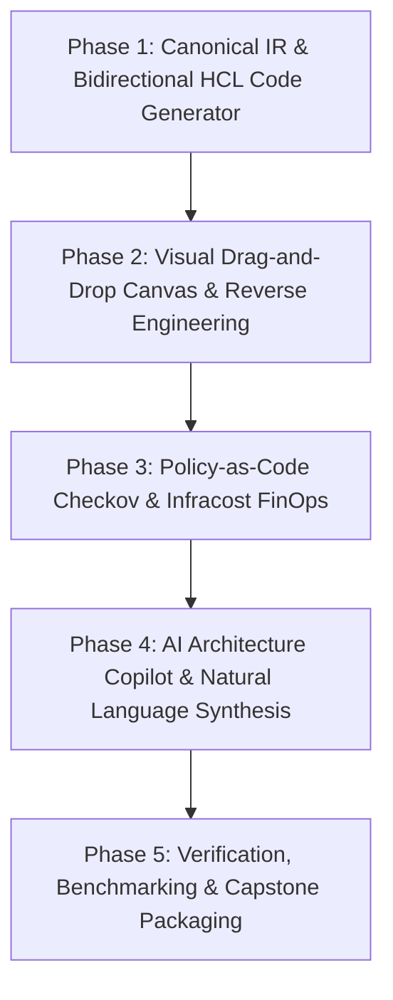

# Project Execution & Development Plan (PLAN.md)

**Project Title:** Azure Cloud Topology Engine: An AI-Powered Terraform Visualizer and Security Copilot  
**Architecture:** Python FastAPI Backend (Python 3.14+) + React Flow Canvas (Node 24+) + Monaco Editor + Checkov + Infracost + Azure OpenAI  
**Status:** Ready for Phase 1 Scaffolding  

---

## 1. Project Objectives & Scope

The goal is to develop a cloud-connected visual cloud architecture designer and Terraform management platform for Microsoft Azure. The platform enables engineers to visually design Azure cloud topologies with real-time bidirectional Terraform code generation, reverse-engineer existing infrastructure (`.tf`, `tfstate`, or live Azure subscriptions), enforce Policy-as-Code (Checkov), calculate real-time FinOps costs (Infracost), and generate/refactor architectures using an AI Copilot.

---

## 2. Phased Development Roadmap



---

### Phase 1: Canonical IR & Bidirectional HCL Generator
- [ ] **1.1 Workspace Setup & Dependencies:**
  - Create `pyproject.toml` targeting Python 3.14+ (`python >= 3.14`).
  - Install backend dependencies: `fastapi`, `uvicorn`, `pydantic`, `python-hcl2`, `jinja2`, `networkx`, `httpx`, `pytest`.
- [ ] **1.2 Canonical Intermediate Representation (IR) (`src/schema/`):**
  - Define Pydantic models for Azure resources, parameters, parent-child container bindings (RG $\to$ VNet $\to$ Subnet), and inter-resource connection ports (e.g. `subnet_id`, `private_endpoint`, `peering`).
  - Create `src/schema/azure_catalog.py` indexing supported Azure resource schemas (Compute, Networking, Storage, Databases, Security).
- [ ] **1.3 Bidirectional Code Generation & HCL Parser:**
  - **HCL Code Emitter (`src/codegen/emitter.py`):**
    - Jinja2 template engine generating formatted, modular HashiCorp Terraform (`.tf`) scripts from Canonical IR.
    - Automatic variable generation, locals, and dynamic attribute references.
  - **HCL Ingestion Parser (`src/parsers/hcl_parser.py`):**
    - Parses `.tf` files using `python-hcl2` into the Canonical IR.
- [ ] **1.4 Roundtrip Sync Testing (`tests/test_ir_sync.py`):**
  - Verify lossless roundtrip synchronization: `Canonical IR -> Generated .tf -> Parsed IR`.

---

### Phase 2: Visual Drag-and-Drop Canvas & Reverse Engineering
- [ ] **2.1 Frontend Initialization (`frontend/`):**
  - Setup React 18 + Vite + TailwindCSS + Lucide Icons.
  - Integrate React Flow 12 (`@xyflow/react`) for canvas and hierarchical containers.
  - Integrate Monaco Editor (`@monaco-editor/react`) for split-view Terraform code editing.
- [ ] **2.2 Visual Canvas & Azure Node Components:**
  - Build left sidebar component palette categorized by Azure service types.
  - Create custom Azure node cards with official SVG icons, status badges, and connection handles.
  - Implement nested container nodes (Resource Group $\to$ Virtual Network $\to$ Subnet).
- [ ] **2.3 Real-Time Bidirectional Synchronization:**
  - Implement state synchronization: Dragging or modifying nodes on canvas emits updated Terraform code in Monaco editor.
  - Editing code in Monaco editor dynamically updates nodes and connections on the visual canvas.
- [ ] **2.4 Reverse Engineering & Cloud Import:**
  - **Terraform State Parser (`src/parsers/state_parser.py`):** Ingests `terraform.tfstate` and `tfplan.json` into Canonical IR.
  - **Live Azure Cloud Importer (`src/parsers/azure_importer.py`):** Connects to Azure Resource Graph (ARG) via Azure SDK to import running subscriptions directly into visual diagrams.

---

### Phase 3: Policy-as-Code (Checkov) & Live FinOps (Infracost)
- [ ] **3.1 Policy-as-Code Engine (`src/security/`):**
  - Integrate **Checkov** (`checkov_runner.py`) for static analysis against generated Terraform code.
  - Map Azure CIS benchmark findings to specific visual canvas nodes (HIGH / MEDIUM / LOW risk badges).
  - Calculate graph-correlated blast radius for publicly exposed or unencrypted resources.
- [ ] **3.2 FinOps Cost Estimation Engine (`src/finops/`):**
  - Integrate **Infracost API** (`infracost_client.py`) to calculate resource-level and total architecture monthly costs.
  - Implement Azure Retail Prices API client as a fallback for direct SKU lookups.
  - Render cost pills on canvas nodes and an aggregate FinOps card in the UI header.

---

### Phase 4: AI Architecture Copilot (Azure OpenAI GPT-4o)
- [ ] **4.1 Natural Language to Architecture Synthesis (`src/copilot/prompt_engine.py`):**
  - Ingest natural language prompts (e.g., *"Build a secure 3-tier web app with Azure App Service, private Azure SQL, and Key Vault"*).
  - Use GPT-4o with structured JSON outputs to generate Canonical IR $\to$ renders visual canvas + ready-to-deploy Terraform code in seconds.
- [ ] **4.2 1-Click Automated Remediation & Refactoring (`src/copilot/remediator.py`):**
  - Click any Checkov security alert or Infracost cost warning to invoke the AI Copilot.
  - Generates unified diffs and automatically applies fixes to both the Terraform code and visual canvas.

---

### Phase 5: Cloud Deployment (ACR + App Services + Azure Functions) & Capstone Packaging
- [ ] **5.1 Frontend Containerization & Deployment:**
  - Create multi-stage `frontend/Dockerfile` (Vite build $\to$ lightweight NGINX Alpine runtime).
  - Build & push frontend image to **Azure Container Registry (ACR)** (`acr.azurecr.io/topology-engine-ui:latest`).
  - Deploy to **Azure App Service (Linux Web App for Containers)** with HTTPS and custom domain configuration.
- [ ] **5.2 Backend API Serverless Microservice (Azure Functions):**
  - Package FastAPI core as a serverless microservice using **Azure Functions Python v2 Model** (`azure.functions.AsgiFunctionApp`) or containerized Function App (`Dockerfile.api`).
  - Push backend container to **ACR** (`acr.azurecr.io/topology-engine-api:latest`) and deploy to **Azure Functions (Flex Consumption / Containerized App)**.
  - Configure **System-Assigned Managed Identity** for passwordless access to Azure OpenAI, Azure Resource Graph (Reader role), and Key Vault.
  - Configure CORS between Azure App Service frontend and Azure Functions API backend.
- [ ] **5.3 Deployment Automation via Terraform (`deploy/`):**
  - Create Terraform configuration (`deploy/main.tf`) that provisions the complete hosting infrastructure on Azure:
    - Resource Group (`azurerm_resource_group`)
    - Azure Container Registry (`azurerm_container_registry`)
    - Linux App Service Plan & Web App for Containers (`azurerm_linux_web_app`)
    - Azure Function App (`azurerm_linux_function_app`)
    - Application Insights & Log Analytics (`azurerm_application_insights`)
- [ ] **5.4 Performance Benchmarking & ISO/IEC 25010 Evaluation:**
  - Benchmark cold-start latency, graph layout computation (<200ms), and 60 FPS rendering on 500+ node topologies.
  - Prepare demonstration and evaluation framework across Functional Suitability, Usability, Performance, and Security.

---

## 3. Directory Structure

```text
.
├── PROJECT.md
├── PLAN.md
├── pyproject.toml
├── Dockerfile.api                      # Azure Functions / API Backend Docker container
├── deploy/                             # Terraform scripts to deploy the platform to Azure
│   ├── main.tf                         # ACR, App Service, Azure Functions, App Insights
│   ├── variables.tf
│   └── outputs.tf
│
├── src/                                # Backend API Microservice (Azure Functions / FastAPI)
│   ├── function_app.py                 # Azure Functions v2 entrypoint (AsgiFunctionApp wrapper)
│   ├── main.py                         # Standalone FastAPI runner & local dev server
│   ├── schema/
│   │   ├── ir_models.py                # Canonical IR Pydantic models
│   │   └── azure_catalog.py
│   ├── codegen/
│   │   ├── emitter.py                  # Jinja2 Terraform HCL code generator
│   │   └── templates/
│   ├── parsers/
│   │   ├── hcl_parser.py               # HCL parser (.tf -> IR)
│   │   ├── state_parser.py             # State parser (.tfstate -> IR)
│   │   └── azure_importer.py           # Azure Resource Graph live importer
│   ├── graph/
│   │   ├── builder.py                  # NetworkX topology builder
│   │   └── layout.py
│   ├── security/
│   │   ├── checkov_runner.py           # Checkov static analysis & CIS policies
│   │   └── blast_radius.py
│   ├── finops/
│   │   ├── infracost_client.py         # Infracost API client
│   │   └── pricing_fallback.py
│   └── copilot/
│       ├── prompt_engine.py            # Natural language to architecture generator
│       └── remediator.py
│
├── frontend/                           # React Flow + Monaco Visualizer SPA
│   ├── Dockerfile                      # Multi-stage NGINX container for Azure App Service
│   ├── nginx.conf                      # SPA routing and reverse-proxy config
│   ├── package.json
│   ├── vite.config.ts
│   └── src/
│
├── tests/                              # Automated test suite
│   ├── test_ir_sync.py
│   ├── test_codegen.py
│   └── test_security.py
└── samples/                            # Sample Azure Terraform architectures
```

---

## 4. Immediate Next Steps

1. Initialize `pyproject.toml` targeting Python 3.14+ with backend dependencies (`fastapi`, `uvicorn`, `pydantic`, `python-hcl2`, `jinja2`, `networkx`, `checkov`, `azure-mgmt-resource`, `openai`).
2. Implement Canonical IR schema in `src/schema/ir_models.py` and `src/schema/azure_catalog.py`.
3. Implement the Jinja2 code generator in `src/codegen/emitter.py` and HCL parser in `src/parsers/hcl_parser.py`.
4. Create sample Azure architectures in `samples/` and validate roundtrip sync in `tests/test_ir_sync.py`.
